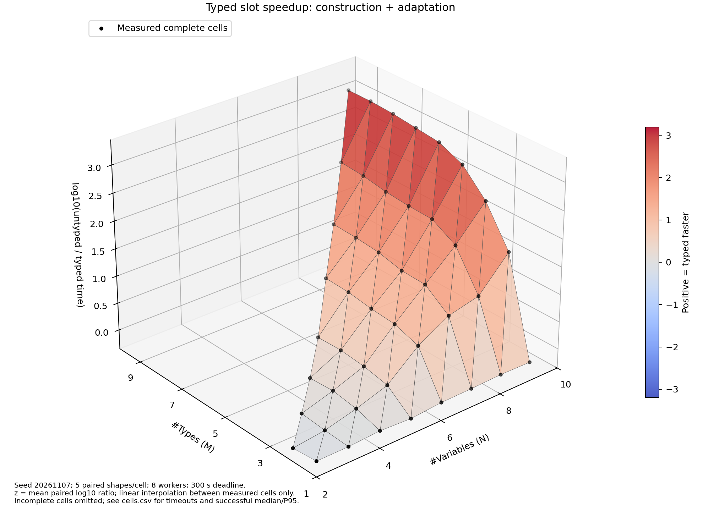
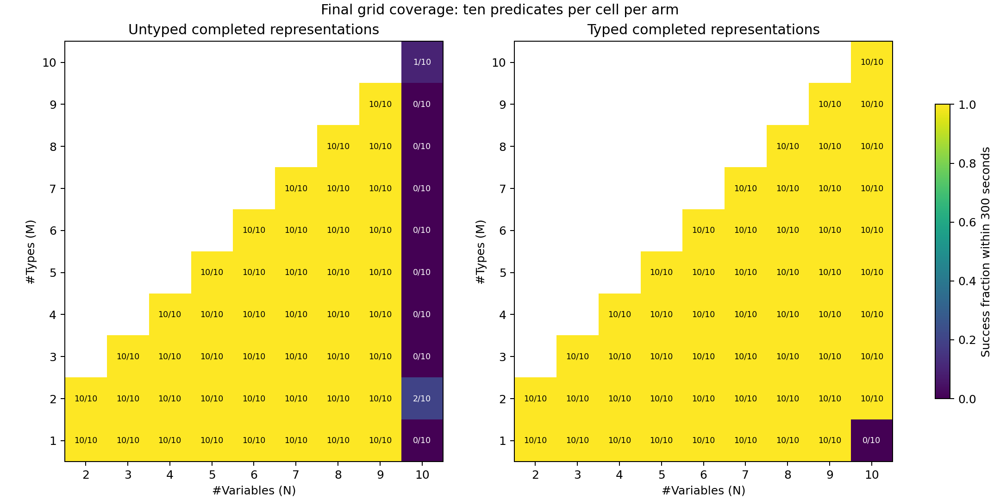

# Final Synthetic Typed/Untyped Grid

Run: `232dea4d-0814-4c6e-8a1d-7e00eed953fd`. Complete matched cells: 44/54.

The primary z-axis is mean log10(untyped/typed engine elapsed time) for the same predicate. Positive means typed faster; z=1 means 10x. Engine timing includes adaptation and representation, not startup/parsing. The secondary figure includes startup/parsing/output. These are concurrent elapsed times, not worker CPU times.

Five generated paired shapes per cell are input replicates, not five independent reruns. All ten predicate measurements must succeed in both arms for a cell to enter the surface. Only adjacent measured cells are joined; no fabricated curves cross missing cells. Success-only median/P95, success rates, and censored statuses remain in cells.csv.

The schedule was continued after a host-memory reserve stop. The first 866 completed records were preserved unchanged, including all timeouts; only 214 interrupted/unstarted trials were executed in the continuation using identical frozen classes, inputs and limits. Timing spans two host-load periods; it is not an uninterrupted or repeated-run estimate.

Raw evidence: `/media/augustus/8618-0ED0/ACGN/final-results/slot-typing-grid-20261107/combined-run`. Source hashes are in surface-data.json.
