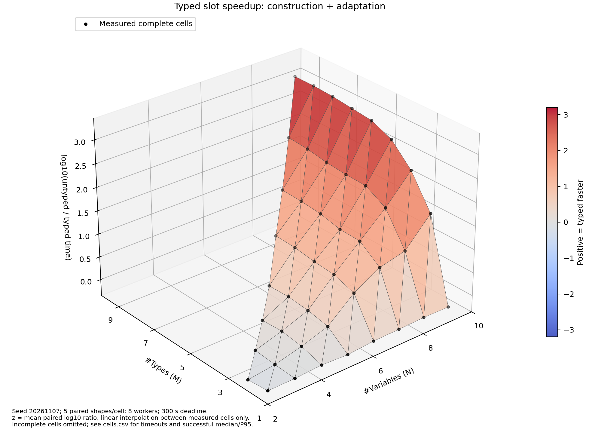
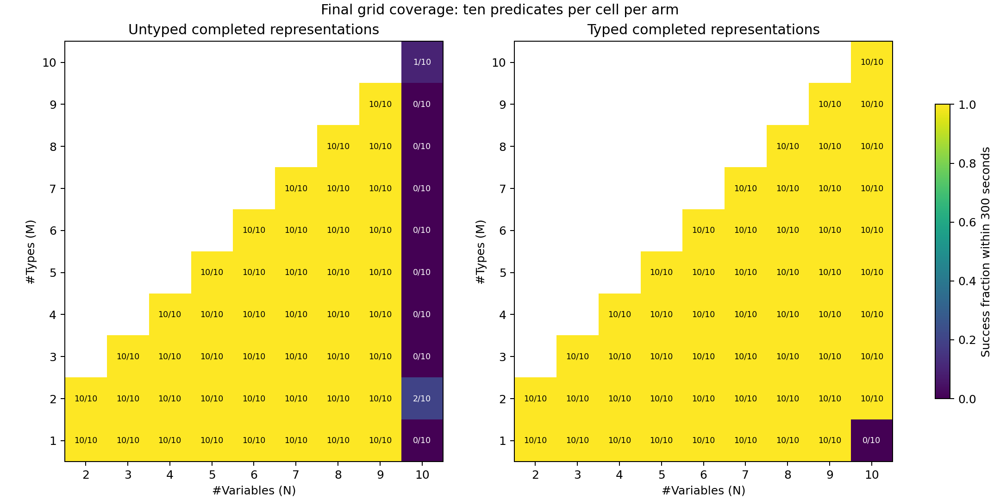

# Final Typed/Untyped Slot-Performance Results

## Population and Protocol

The regenerated dataset contains all 54 combinations of N variables (2 <= N <= 10)
and M types (1 <= M <= N), with five paired shapes per cell: 270 pairs, 540
predicates, and 1,080 predicate/arm trials. Each type receives floor(N/M) or
ceil(N/M) bindings, with seeded random remainder selection and variable assignment.
Every type is inhabited in the source model and every variable is used. Total
predicate binder counts include temporal references but no additional local binders.

The five shapes exercise alpha conversion, Boolean ACI, implication, future
temporal, and past/future temporal contexts. Structural seeds are independent
of M. This is a controlled performance grid, not full-grammar coverage.

Both arms used the same frozen implementation, eight concurrent isolated JVMs,
one active processor per JVM, 768 MiB heap each, and a 300-second deadline per
predicate. Synthetic representation search was uncapped. Host safeguards were
an 8 GiB shared cap, no service swap, 6 GiB available-memory reserve and 32 GiB
free-disk reserve. Neither slot arm emits semantic certificates.

## Results

- Typed: 530/540 successes (98.1481%); 10 timeouts.
- Untyped: 443/540 successes (82.0370%); 97 timeouts.
- Complete schedule: 973 successes and 107 timeouts; zero final OOM, execution
  errors, interrupted trials, or unstarted trials.
- All 270 source pairs passed parser/AST-adapter validation, including actual
  binder count, distinct types, type-histogram balance and used-variable checks.

Successful whole-JVM runtime median/P95, including startup, parsing and output:

- Typed: 0.164246 / 1.965355 seconds (530 successes).
- Untyped: 0.800978 / 44.647240 seconds (443 successes).

Successful engine elapsed-time median/P95, excluding startup and parsing but
including adaptation and representation construction:

- Typed: 0.026833 / 1.803044 seconds (530 successes).
- Untyped: 0.671134 / 44.440920 seconds (443 successes).

The independent success populations differ. For the 443 exact predicates that
succeeded in both arms, typed engine median/P95 is 0.025220 / 0.923250 seconds;
untyped is 0.671134 / 44.440920 seconds. These marginal medians are not paired
speedup estimates. The figures instead aggregate exact-predicate log ratios.
P95 is nearest-rank. These are elapsed times under concurrency, not CPU totals.

## Surfaces and Censoring

X is #Variables, Y is #Types, and Z is the mean of
`log10(untyped_time / typed_time)` across the ten exact matched predicates per
cell. Exponentiating Z gives geometric-mean paired speedup. Positive values
favor typed. Triangles interpolate only between adjacent measured complete
cells; no fitted smoothing, extrapolation, or deadline-imputed timings are used.

[PDF](engine-speedup-surface.pdf). A separate [whole-JVM surface](wall-speedup-surface.png)
includes startup, parsing and output. Machine-readable values and successful
median/P95 per cell are in [cells.csv](cells.csv) and [surface-data.json](surface-data.json).

All 44 cells with N <= 9 completed in both arms. The maximum fully observed
engine speedup was approximately 1,576.59x at N=9, M=9 (Z=3.197719).
Homogeneous M=1 cells have no permutation reduction and show small typed
overhead rather than a speedup. At N=2, M=2, typed was also slower in this
measurement; small-instance overhead/noise must not be hidden by a monotonic fit.

Every timeout was at N=10. Typed succeeded on all 90 mixed-type predicates and
timed out on the ten homogeneous predicates. Untyped succeeded on only three:
two at M=2 (287.093 and 288.902 seconds) and one at M=10 (299.910 seconds).
These are near the cutoff and especially sensitive to scheduling/host load.
No N=10 cell has a complete matched sample, so none is assigned an exact
surface height. Its outcomes remain visible below and in the raw data.

## Interpretation

For an admissible independent block, untyped enumeration explores N! assignments,
while typed enumeration explores the product of each type group's factorial.
Balanced mixed-type blocks make the latter much smaller. A homogeneous block
has the same factorial search in both arms, plus type-processing overhead.
The observations support this mechanism within the tested grid; type partitioning
does not eliminate factorial growth within a large homogeneous type group.

The N=10 censored outcomes are legitimate negative results, not crashes and
not grounds for dropping inputs. A timeout does not establish semantic failure
or non-equivalence. No claim of universal runtime superiority follows from this
single parallel schedule or its five input shapes per cell.

## Continuation and Evidence

Combined run: `232dea4d-0814-4c6e-8a1d-7e00eed953fd`.
Raw evidence root:
`/media/augustus/8618-0ED0/ACGN/final-results/slot-typing-grid-20261107`.

The original attempt stopped when other desktop workloads reduced host available
memory below the 6 GiB reserve. It retained 866 completed observations (786
successes, 80 timeouts), eight interrupted trials and 206 unstarted trials.
After the user freed memory, only those 214 incomplete trials were continued
using the identical frozen classes, libraries, sources, limits and worker count.
No completed success or timeout was rerun or replaced. The finalization check
compared all 866 preserved records for exact equality and verified the original,
continuation and combined checksum inventories.

The combined observation window was 05:50:15 to 07:15:11 America/Chicago on
2026-11-07, including the interruption. It is not an uninterrupted run. Host
contention, continuation and fresh-JVM startup constrain generalization; no
confidence intervals or repeated-run stability claims are made.

`evidence-index.json` links source hashes and the frozen source snapshot. The
source checkout had uncommitted benchmark/validator changes, explicitly recorded
as dirty; it is not falsely attributed solely to the base Git commit. No
production rewrite engine was changed. Full representations, per-trial logs,
timings, both attempt manifests, resource telemetry, classes and libraries are
retained externally. Compact final observations are also preserved here.

## Verification

- BalancedGrid.lean: five allocation/bound theorems checked.
- StressSchemas.lean: ten construction laws checked.
- TimedOutcome.lean: four deadline/outcome theorems checked.
- Python: 17 generator/statistics/deadline tests passed.
- Java: SlotTypingSyntheticTest 18 checks and SlotTypingAblationTest 46 checks
  passed; EGraph ablation regression tests passed.
- Generated sources reproduced byte-for-byte; 270/270 pairs validated.
- Preserved natural evidence: 7,164 file hashes checked; original stage-bound
  checks verified 5,826 entries. No natural result changed.

Lean proofs cover the stated mathematical laws, not Python PRNG uniformity,
whole Java refinement, solver completeness, or every runtime claim. Proof logs
disclose standard logical axioms; there are no new axioms or proof placeholders.
