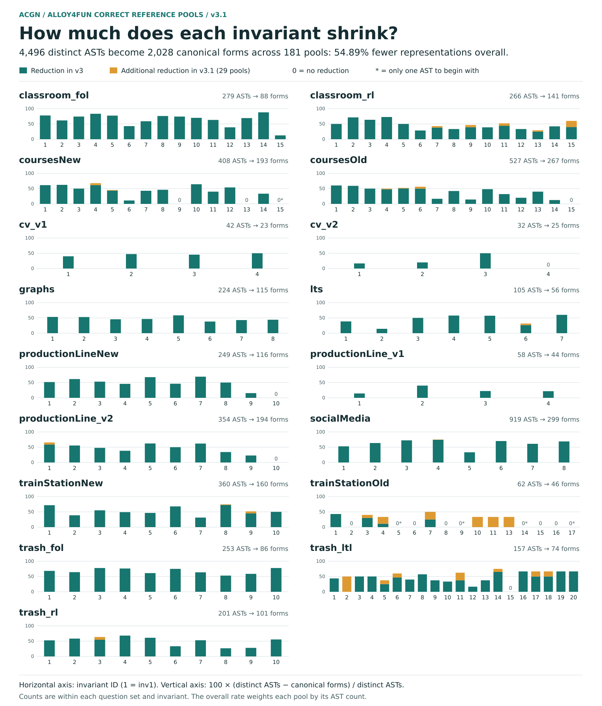

# Representation reduction by invariant · ACGN v3.1

On the same **4,496 distinct correct ASTs**, v3.1 produces **2,028 canonical forms**, down from **2,074 in v3**. The pooled reduction rises from **53.87% to 54.89%** (+1.02 percentage points). Of the 181 invariant pools, **29 improved, 152 were unchanged, and none regressed**.

[Full-size vector figure](per-invariant.svg) · [Download all 181 rows](per-invariant.csv) · [v3 baseline](v3-question-pools.csv) · [v3.1 counts](../2026-11-21/question-pools.csv)

Each panel is a question set. The horizontal axis is the invariant ID; the bar height is `100 × (ASTs − canonical forms) / ASTs` for that invariant. Forms are connected components under measured zero distance within the same correct-reference pool. We do not merge across questions or invariants. The headline weights each pool by its AST count; it is not the mean of the bar heights. **164 pools shrink**. Of the 17 that do not, five started with only one AST.

## What changed

- **Unary restriction and intersection now meet at the same representation.** In `classroom_rl/inv11`, one correct answer has `some (Teaches.c & Teacher)`; another has `some Teacher <: Teaches.c`. Because `Teaches.c` is unary, both select exactly the teachers in that set. This pool went from 14 to 12 forms among 25 ASTs. Restricting a binary relation still filters a column; it is not replaced by ordinary intersection.
- **Static domains allow a temporal quantifier to move.** In `trainStationOld/inv10`, one answer starts `always (all j:Junction | ...)`; the oracle starts `all j:Junction | always ...`. The set of junctions is static, so both range over the same junctions at every future instant. These answers also use different spellings of the unary green-signal filter. The pool fell from six forms to four; all nine satisfiable counterexample pairs in the focused controls stayed distinct. If the carrier can change, moving the quantifier could change which atoms are checked, so the rule does not apply.
- **Next-state observations preserve the binding instant.** In `trash_ltl/inv2`, `no File and after some File` and a conjunction of `no File` with `some File'` now coincide. The rule observes the mutable carrier in the next state; it does not silently rebind an already captured atom. This pool fell from four forms to two.

These examples come from the [source-pair gains](../2026-11-21/correct-pool-gains.json). They illustrate the rules; they do not apportion the gains among individual rules. The [Lean laws](../../section3-repair-audit/formal/Phase5SourceRules.lean) and [Java controls](../../../src/is/fivefivefive/CanDis/CapabilitySourceSchedulingTest.java) specify their limits.

**Why 46 fewer forms but 275 more equal pairs?** Merging two previously separate classes of sizes `a` and `b` removes one form but adds `a × b` equal unordered pairs. Across the correct pools, zero-distance pairs increased from 11,607 to 11,882, with no previous zero lost. The separate student-versus-oracle experiment gained 239 zero pairs; those must not be added to the 275.

## Reproduce the figure

Run `python3 render.py` in this directory. The renderer uses the standard library, checks that both inputs contain exactly the same 181 pools and AST counts, and writes the SVG and CSV in numeric invariant order. The [original v3.1 report](../2026-11-21/README.md) remains the record for the paired and full-reference experiments.

## Other experiment arms: not run

The v3.1 preflight passed for the original 66,080 natural files and the frozen 5,500 capability cases. An initial harness-loading failure occurred before any case ran; the corrected preflight used the verified, nonshadowing study harness. **Preflight is not a measurement.** No natural ablation, capability, natural slot-typing, or synthetic timing result was produced on this attempt. The [v3 study results](../2026-11-16/README.md) remain historical.

Launch review found that the study supervisor did not independently bind the child's output digest at guarded completion or pin the exact previously accepted receipt on subsequent checks. The report stages also need fresh destinations and first-failure stopping for the bounded soundness check. These findings concern the supplemental study runner, not the canonical reductions plotted above. See the [measurement status and receipt hashes](study-status.json).
