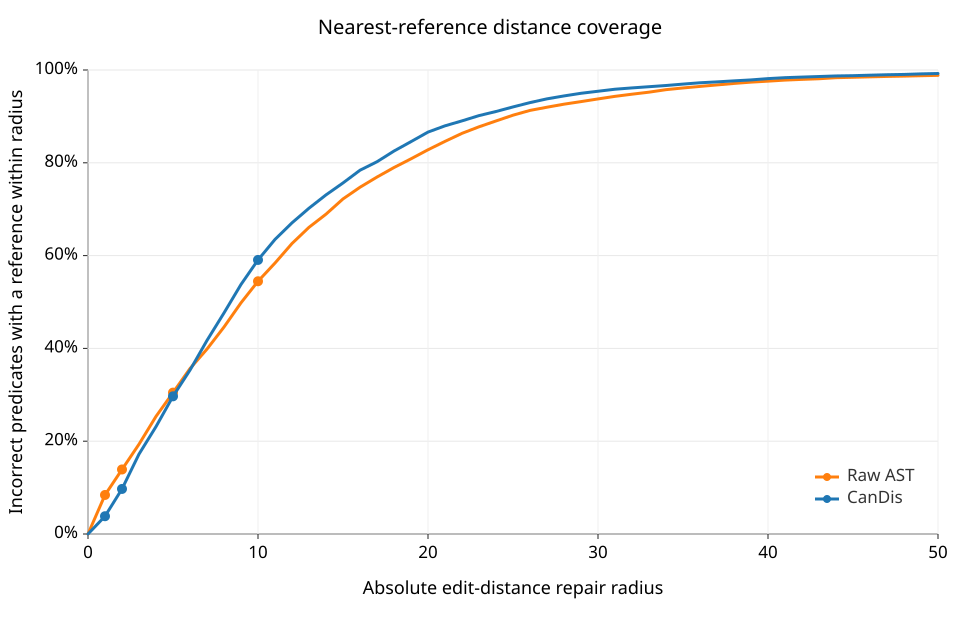

# Historical pair retention after v3.3

Fast Rewrite and Certificate-Integrated recovered all seven reference pairs that v3.1 recognized and v3.3 lost. Both paths also retained every recorded positive in the earlier editions of the same corpus. The full run measured commit `9693595eb4f60c6c70b6d8d174ee309d1fdcf9aa` on a clean checkout. The dataset contained 66,080 files. Independent replay workers ran on the same host. The recorded wall-clock times include that load. [Run receipt](run-receipt.json) · [Headlines](headlines.json) · [All recoveries by source](repaired-reference-pairs.csv)

## Student–oracle and reference-pool results

Of the 19,212 correct pairs with distinct ASTs, each rewrite path recognized **5,137** at zero structural distance. That is 638 more than v3.3. Both retained all 2,228 original Slotted zeros and recognized 2,909 additional correct pairs. Neither returned zero on the 42,386 labeled incorrect submissions. Both the scalar distance and the replayed operations agreed on all 61,598 measured files. The other 4,482 files had identical ASTs. At the original command bounds, the native checker found no counterexample to the 5,137 structural zero claims. Fixed-command rules recognized 259 further correct pairs with positive structural distance. [Seven-arm distances](ablation-distances.csv.gz) · [Batch decisions](paired-comparisons.jsonl.gz) · [Bounded semantic checks](bounded-natural-checks.json.gz)

The 181 correct-reference pools contained 4,496 distinct reference ASTs and 132,032 unordered within-pool pairs. Both paths recognized **19,271** direct structural zeros, including all 8,952 original Slotted zeros. Of these structural zeros, 7,077 were new relative to v3.3. The native Alloy solver found no counterexample for any of those gains at its archived command. [Every structural and fixed-command decision](correct-pool-pairs.jsonl.gz) · [Original Slotted distances](slotted-reference-pairs.csv.gz) · [Native outcomes for all new zeros](native-pool-gains.jsonl.gz)

Grouping references by the structural zero relation gave **1,816 structural forms**. Adding the 1,234 native-checked fixed-command links and taking connected components gave **1,743 fixed-command components**. Links apply within their recorded command and bounds. All 105 historical native counterexample pairs stayed in separate components. [Counts by invariant](correct-pools.csv)

Both engines agreed on all 1,894,168 paid reference scores for 42,386 incorrect submissions. Their mean distance to the nearest reference was 11.478, compared with 12.267 for the raw AST. The ranking ledger stores the submission path, reference IDs, Fast distances and Certificate-Integrated distances in that order on each JSON line. Reference IDs resolve against the v3.2 archive. [All ranking scores](ranking-scores.jsonl.gz) · [Nearest distances](nearest-distances.csv.gz) · [Reference IDs](../2026-11-25/references.jsonl.gz)



The chart connects coverage at consecutive integer edit radii, using the v3.1 figure style with the legend at bottom right. Each point includes all submissions within that radius. The earlier step rendering held the count constant between adjacent integer radii, then jumped when the next radius added submissions. [Counts at each radius](repair-coverage.csv)

## Native operation replay

Both engines independently replayed their selected native edits from the frozen normalized IR. The ordered actions matched on all 61,598 AST-distinct student–oracle pairs and all 19,271 structurally zero reference pairs, including the seven CV regressions. The run receipt records zero unchecked, invalid, errored or mismatched student–oracle replays. Public certification of the complete source-to-edit sequence remains `BLOCKED`. [Per-file replay verdicts](paired-native-replays.csv.gz) · [Run receipt](run-receipt.json) · [Reference replay ledger](native-reference-traces.jsonl.gz) · [Trace summary](native-reference-summary.json)

All 4,138 paid comparisons selected for repeated quantifiers across an alternating prefix matched. A separate seeded sample of one paid comparison from each of the 181 pools also matched, including 38 temporal cases checked by their ordered block effects. The full ranking check compared both engines’ scalar distances on all 1,894,168 pairs. The witness fix preserved every student–oracle and paid ranking distance from the preceding run. [Cohort and score binding](final-cohort-binding.json) · [One paid trace per pool](stratified-native-traces.jsonl.gz) · [Sampling method](stratified-native-summary.json) · [Comparison between runs](intermediate-comparison.json)

In the preceding run, both engines had assigned the same distance to 83 paid pairs while choosing different equal-cost edits. Their forward traces had matched on 57 of those pairs in v3.3 and already differed on 26. In 82 cases the reference was ID 3278, and in one it was ID 3262. Fast Rewrite had given a partial binder mapping priority as if it were a complete witness. Both engines now rank eligible equal-cost choices by the surviving declaration positions, with an existing complete witness taking priority over completion of a partial mapping on an exact tie. All 83 now match in both directions under the permanent release check. [Per-direction check](paid-rank-witnesses.json) · [Historical attribution](../historical-retention-before-trace-fix/paid-witness-attribution.jsonl) · [All 83 repaired traces](repaired-third-rank-traces.jsonl)

## Where v3.3 lost pairs

The seven immediate losses were `cv_v1/inv1` reference IDs {1484, 1486, 1487} × {1488, 1489} and `cv_v2/inv1` IDs 1524 and 1526. Each pair went from distance zero in v3.1 to 12 in both v3.3 paths and back to zero here. In `d5c0c2a0`, the source normalizer recognized the restricted range in `all w: u.visible | …` but required a named subsignature when the same restriction was written as a guard over `Work`. The repair uses the declared range of the resolved field in both spellings. A shadowed relation name cannot authorize the rewrite. [Original seven observations](../v3.3/changed-v31-pool-zeros.json) · [Lean theorems](../../section3-repair-audit/formal/HistoricalCVPairs.lean)

Searching older archives found 335 additional lost direct reference pairs covered by v2. Replaying all 335 pairs at seven revisions located the first positive distance for each pair. One first became positive at `ef46feae` during bottom-up vacuity handling, four at `7eb661b1` during guarded pre-liveness normalization, and 330 at `2d70f89a` when early membership folding preempted a common normalized spelling. An earlier artifact freeze added another 841 distinct reference losses and six `trash_ltl/inv14` student–oracle losses. For the 841, the attribution study traces 14 selected examples across the source transition. [335 revision histories](first-regressions.csv) · [Earlier freeze cases](artifact-freeze-attribution.json) · [Six original-file losses](repaired-student-oracle.csv)

In total v3.3 had lost **1,183** historical reference pairs. It also missed 781 direct reference zeros found by original Slotted. The sets overlap on 582 pairs, yielding **1,382 distinct recovered reference pairs**. The before/after ledger records both paths, predicates, v3.3 numeric distances, current distances and original command digest for every identity. All 781 original-Slotted recoveries also survived native checks at three additional overall scopes. [Complete recovery ledger](repaired-reference-pairs.csv) · [Additional scope checks](scope-sweep.jsonl.gz)

## Lean and future editions

Lean checked the equivalence of the two archived Alloy predicates separately for each of the seven CV pairs. A source check verifies the archive digests, selected predicate bodies and declared field range before comparing their Lean transcriptions. These theorems allow empty and infinite carriers and depend on no axioms. Lean also checked 20 rewrite lemmas. Seventeen are axiom-free and three use standard Lean classical axioms. The larger historical inventory has individual engine and bounded native evidence. A proof of the whole Java pipeline and individual Lean statements for that larger inventory remain open. [Axiom inventory](lean-receipt.json) · [Rewrite lemmas](../../section3-repair-audit/formal/Phase5SourceRules.lean) · [Source checker](../../../scripts/check_historical_cv_proofs.py)

The full-run gate compares identities in both engines against every recorded edition, including 5,137 prior student–oracle structural zeros, 19,271 direct reference zeros, and the separately recorded fixed-command obligations. A dropped direct pair fails the run even when another pair is gained. Both structural sets must strictly include original Slotted. Every passing edition writes an additional coverage floor. [Historical retention report](historical-coverage.json) · [Floor for future editions](historical-pairs.json.gz) · [Reproduction instructions](../../historical-pair-coverage/README.md)

Two diagnostic runs exposed paid-distance regressions before the final run. Splitting grouped declarations had changed 362 natural distances. Restoring their grouping brought all 362 back to the independently replayed certificate cost. On a separate `socialMedia/inv7` ranking, Fast Rewrite had scored 85 by swapping two universal binders across an intervening existential. Preserving the order of the matched quantifier blocks restored 87 in both directions. Legal exchanges within a block and partial alignments that skip a block still pass their controls. [Grouped-declaration cases](paid-parity-repairs.csv) · [Ranking incident](ranking-incident.json) · [Classfile reproduction](build-replay.json)

Lean checked six additional results about witness selection, including the concrete declaration permutations of the 116-edit case. The finite search model preserves scalar minima when admitted choices are reordered. A full Java-to-Lean refinement remains open. [Lean witness model](../../section3-repair-audit/formal/SurvivorWitnessOrder.lean) · [Lean audit](witness-lean.json)

The current bounded CI suite passed. A separate archival parity harness contains version-specific expectations. With repository provenance supplied, 38 of its 83 standalone checks passed on both the preceding repair and the candidate, and 45 failed on both. Genuine source replays in the audited archival inputs matched. The archived harness remains outside the passing historical-pair gate. [Archival checks and failure reasons](archival-status.json) · [Current independent checks](candidate-independent-verification.json)

Run `python3 -B verify.py` in this directory to check the exported hashes and recount the measurements. [Updated paper](paper-historical-retention.pdf) · [Repair coverage figure](repair-coverage.pdf) · [Counts by edit radius](repair-coverage.csv)

### Reproducing the reference trace supplement

The [replay input](native-reference-inputs.tsv.gz) gives each comparison's cohort, source path, original predicate, and SHA-256 for each endpoint, followed by its measured distance. The [Java driver](ReferenceTrace.java) accepts this TSV on standard input. From the results checkout, set `JAR` to the experiment JAR built from the measured commit. Its SHA-256 is recorded in the run receipt. The output contains one JSON object per directed replay.

```sh
evidence=docs/experimental-results/historical-retention
classes=$(mktemp -d)
javac --release 17 -cp "$JAR:lib/*" -d "$classes" "$evidence/ReferenceTrace.java"
gzip -dc "$evidence/native-reference-inputs.tsv.gz" | java -Xmx512m -cp "$classes:$JAR:lib/*" is.fivefivefive.CanDis.ReferenceTrace classified-data - - > "$classes/replays.jsonl"
```

The [export verifier](verify_native_reference_replays.py) binds the published receipts to those original file hashes, independently checks the complete set of structural zero pairs, and checks all targeted and sampled paid native costs against both full ranking vectors.
